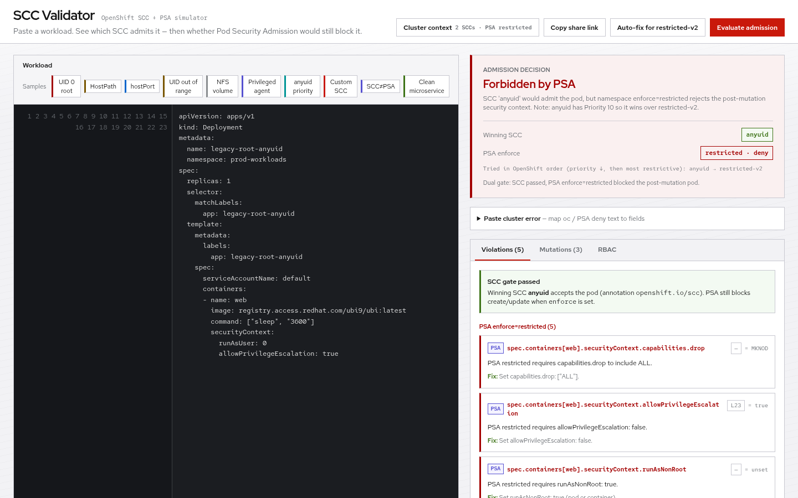
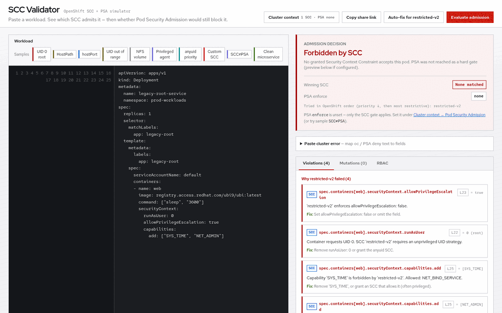

# SCC Validator

**Paste a pod YAML and see why OpenShift rejects it — in your browser, no cluster login required.**

Client-side OpenShift **Security Context Constraint (SCC)** + **Pod Security Admission (PSA)** simulator.



Short demo loop (SCC deny → SCC≠PSA dual gate):



Live app: https://vinashar-rh.github.io/scc-validator/

Paste a workload YAML, set (or import) the project / ServiceAccount context, and see:

- whether **SCC** admission would **allow** or **forbid** the pod
- **which SCC wins** (OpenShift order: higher priority → more restrictive → name)
- whether **PSA** (`enforce` / `warn` / `audit`) would still block the **post-SCC-mutation** pod
- **why other granted SCCs failed**
- **mutations** the winning SCC would inject
- a ready-to-copy **RBAC grant** if you need a higher SCC

## When to use it

Use this tool when you need to **reason about SCC admission without burning cluster iterations** — especially before you have access, or while you explain a failure to someone else.

**Good fits**

- A pod / Deployment is rejected with `unable to validate against any security context constraint` and you want a clear field-level why
- You are deciding whether to **fix the workload** for `restricted-v2` or ask for a higher SCC (`anyuid`, `hostnetwork-v2`, `privileged`)
- Training / demos: show how UID 0, HostPath, `hostPort`, and privileged DaemonSets fail under a normal project
- Reviewing a PR manifest on a laptop without `oc` login (needs internet for CDN assets — see below)
- Checking what OpenShift would **mutate** (injected UID, seccomp, `openshift.io/scc`, etc.) if admission succeeded
- Sharing a failing case with a teammate via **Copy share link**

**Not the right tool when**

- You need a definitive cluster answer → use `oc create --dry-run=server` / `oc adm policy scc-subject-review`
- The deny involves image `USER` inspection (not simulated)
- You need exact PSA version pinning / Windows HostProcess edge cases beyond the built-in profiles
- You must prove what is granted in a live project → export RoleBindings / run `oc adm policy who-can use sccs/...` (then import here if you want)

This is a **teaching / diagnostics workbench**, not a replacement for the API server. Always confirm on-cluster with:

```bash
oc create --dry-run=server -f workload.yaml
oc adm policy scc-subject-review -z <sa> -n <ns> -f workload.yaml
```

Workload YAML and cluster context stay in the browser. Evaluation does not upload them to a backend. The page does load Tailwind CSS and js-yaml from a CDN, so the first load needs internet.

---

## Quick start

1. Open the app.
2. Paste a `Pod`, `Deployment`, `StatefulSet`, `DaemonSet`, `Job`, `CronJob`, or similar into **Workload**, or click a **Sample**.
3. Open **Cluster context** and confirm:
   - namespace / ServiceAccount
   - UID range and SELinux MCS (or import them from cluster YAML)
   - PSA labels — default **typical OpenShift project**: `warn`/`audit=restricted`, `enforce` unset (SCC decides; warn findings still show)
   - which SCCs that ServiceAccount may use (default: `restricted-v2` only)
4. Read **Admission decision** (SCC + PSA pills). On deny, open **Violations** (tagged SCC vs PSA) and click a finding to jump to the YAML line.
5. Optional: open **Paste cluster error** and drop in an `oc create --dry-run=server` Forbidden message — the app detects SCC vs PSA, sets enforce when needed, and jumps to a matching YAML field.
6. Optional: **Auto-fix for restricted-v2**, or use the **RBAC** tab if the workload truly needs a higher SCC.
7. Optional: **Copy share link** to send someone the same YAML + context. Deep-link a sample with `?sample=psagate` (or any sample key).

---

## Cluster context

The app never talks to your cluster. You either edit the fields by hand or import exports.

### Default assumption

A new OpenShift project almost always has only **`restricted-v2`** (via `system:authenticated`).  
Tick `anyuid`, `privileged`, etc. only if a cluster-admin already granted them.

### Import from the cluster

In **Cluster context → Import cluster context**, the app shows commands like:

```bash
# Namespace UID range + MCS annotations
oc get ns <ns> -o yaml > ns.yaml

# Project RoleBindings (add-scc-to-user usually lands here)
oc get rolebinding -n <ns> -o yaml > rb.yaml

# ClusterRoleBindings that grant SCCs (optional)
oc get clusterrolebinding -o name | grep ':scc:' | while read -r r; do oc get "$r" -o yaml; echo '---'; done > crb-scc.yaml

# All SCC objects, including custom ones
oc get scc -o yaml > sccs.yaml
```

Then **Upload YAML** or paste into the box and click **Apply pasted YAML**.

| Export | Used for |
|--------|----------|
| Namespace / Project | Name, `openshift.io/sa.scc.uid-range`, `openshift.io/sa.scc.mcs`, PSA labels `pod-security.kubernetes.io/{enforce,warn,audit}` (or use **Typical OpenShift project**) |
| RoleBinding / ClusterRoleBinding (`system:openshift:scc:*`) | SCCs available to the ServiceAccount |
| ServiceAccount (optional) | SA name |
| `SecurityContextConstraints` (`oc get scc`) | **Stock + custom SCC rules** the simulator will evaluate |

If a RoleBinding grants an SCC whose YAML was not imported, the app names it and asks you to paste `oc get scc <name> -o yaml`. Custom SCCs show as extra chips; you can tick or remove them.

### Custom SCCs

The five stock SCCs are always available. Paste a `kind: SecurityContextConstraints` object (or `oc get scc -o yaml`) to **load its rules** into the simulator: capabilities, host namespaces, volumes, runAsUser strategy, priority, etc. The **Custom SCC** sample loads `netadmin-nonroot` (priority 5, `NET_ADMIN` / `NET_RAW`) against a packet-capture pod — `restricted-v2` fails; the custom SCC wins.

This is still an approximation of admission, not `oc create --dry-run=server`.

---

## Reading the result

### Admission allowed

- **Winning SCC** is the first granted SCC that accepts the pod under OpenShift sort order.
- **PSA enforce** (if set) is evaluated on the **mutated** pod — same dual-gate order as the API server.
- **Mutations** lists fields the SCC would inject (UID, `seccomp`, `openshift.io/scc`, etc.).
- If both `restricted-v2` and `anyuid` are granted, a pod that could pass either often gets **`anyuid`** because it has priority **10**. Use the **anyuid priority** sample to see that.

### Admission forbidden

- **Forbidden by SCC** — no granted SCC accepts the pod. Violations are grouped per SCC.
- **Forbidden by PSA** — an SCC won, but `enforce=baseline|restricted` rejects the post-mutation spec. Use the **SCC≠PSA** sample (`anyuid` + `enforce=restricted` + root container).
- Findings are tagged **SCC** or **PSA**. Click a row (or its `L12` badge) to jump to the YAML line.
- **RBAC** suggests a least-privilege stock SCC grant (`oc adm policy add-scc-to-user` + RoleBinding). Prefer fixing the pod for `restricted-v2` when possible.

### Paste cluster error

Under the admission card, **Paste cluster error** accepts Forbidden text from `oc create --dry-run=server` / the API:

- `unable to validate against any security context constraint` → treated as an SCC deny; jumps to a matching field when present in the YAML
- `violates PodSecurity "restricted:…"` (or baseline) → sets PSA **enforce** to that profile, re-evaluates, jumps to the first matching field (e.g. `allowPrivilegeEscalation`, `runAsUser`)

### Auto-fix

**Auto-fix for restricted-v2** rewrites the pasted YAML toward a restricted-friendly shape (drops host namespaces / hostPath-style volumes where needed, strips root UID / privileged, sets drop `ALL` + `NET_BIND_SERVICE`). Review the diff before using it in Git.

---

## Samples

| Sample | What it shows |
|--------|----------------|
| UID 0 root | Explicit root + extra capabilities → denied on `restricted-v2` |
| HostPath | Host filesystem mount → denied |
| hostPort | `hostPort` requires `hostnetwork-v2` / privileged |
| UID out of range | `runAsUser` outside namespace UID range |
| NFS volume | Non-trivial volume type vs restricted volumes |
| Privileged agent | DaemonSet needing `privileged` |
| anyuid priority | Clean pod with `restricted-v2` **and** `anyuid` checked → `anyuid` wins |
| Custom SCC | Pod with `NET_ADMIN` + imported `netadmin-nonroot` SCC |
| SCC≠PSA | `anyuid` admits root pod; PSA `enforce=restricted` still forbids |
| Clean microservice | Passes `restricted-v2` (and PSA restricted if you enable it) |

### Expected outcomes (gold set)

Defaults unless noted: namespace UID range `1000670000/10000`, only `restricted-v2` granted, PSA **warn/audit=restricted**, **enforce unset** (use **Typical OpenShift project** to reset).

| Sample | Winning SCC | PSA enforce | Overall |
|--------|-------------|-------------|---------|
| UID 0 root | none | none | Forbidden by SCC (PSA warn findings may also list) |
| HostPath | none | none | Forbidden by SCC |
| hostPort | none | none | Forbidden by SCC |
| UID out of range | none | none | Forbidden by SCC |
| NFS volume | none | none | Forbidden by SCC |
| Privileged agent | none | none | Forbidden by SCC |
| anyuid priority | `anyuid` | none | Allowed (PSA warnings — anyuid does not harden for restricted) |
| Custom SCC | `netadmin-nonroot` | none | Allowed (likely PSA warnings for extra caps) |
| SCC≠PSA | `anyuid` | `restricted` | Forbidden by PSA |
| Clean microservice | `restricted-v2` | none | Allowed |
| Clean microservice + enforce=restricted | `restricted-v2` | `restricted` | Allowed |

---

## Shareable URLs

**Copy share link** (top bar) copies a URL whose hash (`#s=…`) embeds:

- workload YAML  
- namespace, ServiceAccount, UID range, MCS  
- PSA enforce / warn / audit  
- which SCCs are checked  
- imported custom SCC definitions (when present)

Anyone opening that link restores the same case. The hash also updates quietly as you edit, so a bookmarked tab stays useful.

Large YAML is gzip-compressed in the hash when the browser supports `CompressionStream`.

---

## What the simulator covers

**Stock SCCs always available:** `restricted-v2`, `nonroot-v2`, `hostnetwork-v2`, `anyuid`, `privileged`.

**Custom SCCs:** supported when you paste or upload `kind: SecurityContextConstraints` YAML (`oc get scc`). Their capabilities, volumes, host flags, runAsUser strategy, priority, and related fields are loaded into the same evaluator.

Checks include (among others): hostNetwork / hostPID / hostIPC, hostPort, volume types, privileged, capabilities, `allowPrivilegeEscalation`, runAsUser / MustRunAsRange / MustRunAsNonRoot, fsGroup range, SELinux MCS, seccomp, typical SCC mutations, and PSA **baseline** / **restricted** profile controls (capabilities, volumes, non-root, seccomp, host namespaces, etc.).

It does **not** fully reimplement OpenShift admission. Still missing or approximate: live image `USER` inspection, PSA version labels, full sysctl / flexVolume matrices, and some edge-case SCC fields. Treat on-cluster dry-run as source of truth.

---

## Run locally

```bash
git clone https://github.com/vinashar-rh/scc-validator.git
cd scc-validator
# any static server, e.g.:
python3 -m http.server 8080
# open http://localhost:8080
```

Single-page app: `index.html`. Tailwind CSS and js-yaml load from a CDN (internet required unless you vendor them).

---

## Visit statistics (anonymous)

GitHub Pages does not show hits on the app URL. The page sends a **privacy-friendly pageview** to [GoatCounter](https://www.goatcounter.com/):

- No cookies / no fingerprinting product
- No account login on the visitor side
- Does **not** send pasted YAML, cluster context, or share-link hashes (path is fixed to `/scc-validator/`)
- Typical dashboard: pageviews, rough uniques, referrers (e.g. LinkedIn vs GitHub)

**Dashboard:** https://vinashar-scc.goatcounter.com

**One-time setup (required):** counts stay empty until you create that site.

1. Sign up at https://www.goatcounter.com/signup  
2. Set the site code to exactly **`vinashar-scc`** (must match `index.html`)  
3. Log in at https://vinashar-scc.goatcounter.com  
4. Open the live app once (ad blockers often block GoatCounter — try a private window if the first hit is missing)

Hits usually appear within a few seconds. Ad blockers under-count.

If `vinashar-scc` is taken, create another code and change both the script URL in `index.html` and this README.

---

## License / trademark note

MIT License — see [LICENSE](LICENSE).

Personal diagnostic tool. Not an official Red Hat product. OpenShift® is a trademark of Red Hat, Inc. If you work at Red Hat (or elsewhere), confirm your employer’s policy before wide promotion or use of trademarks in marketing.
